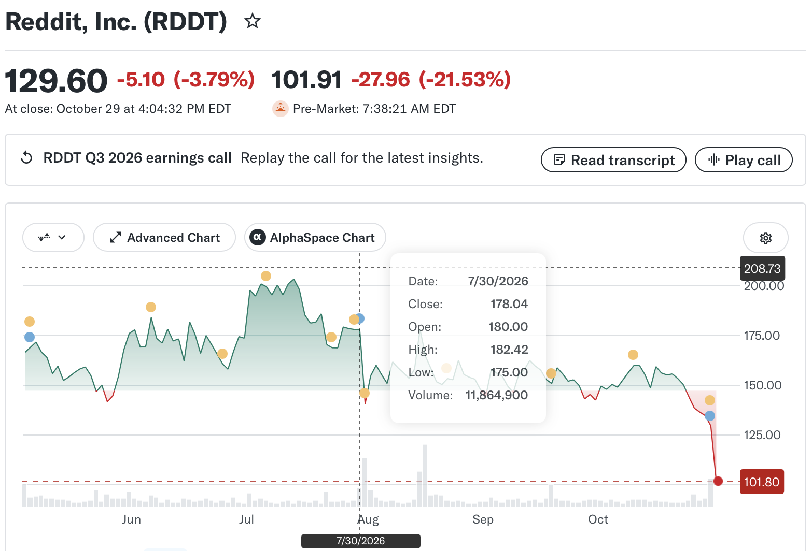
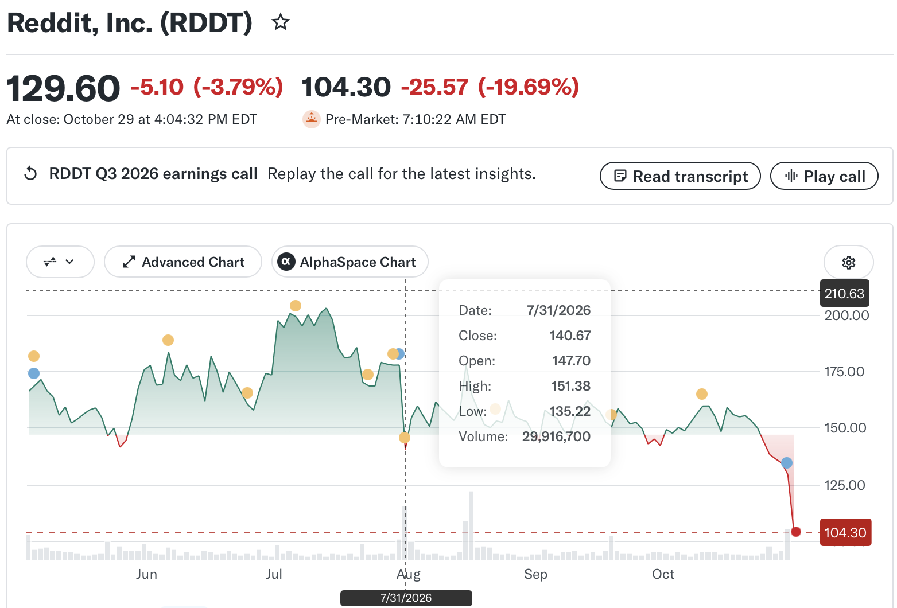
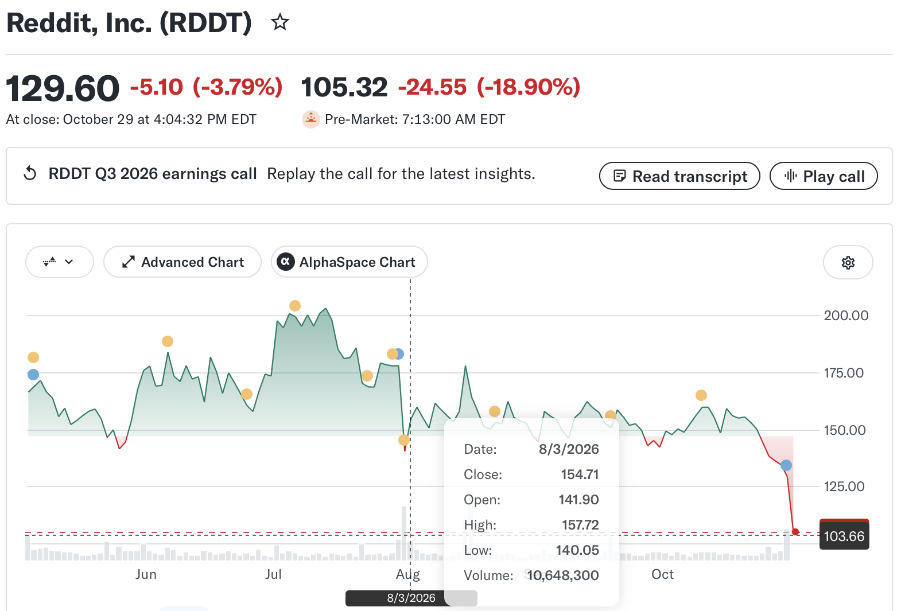
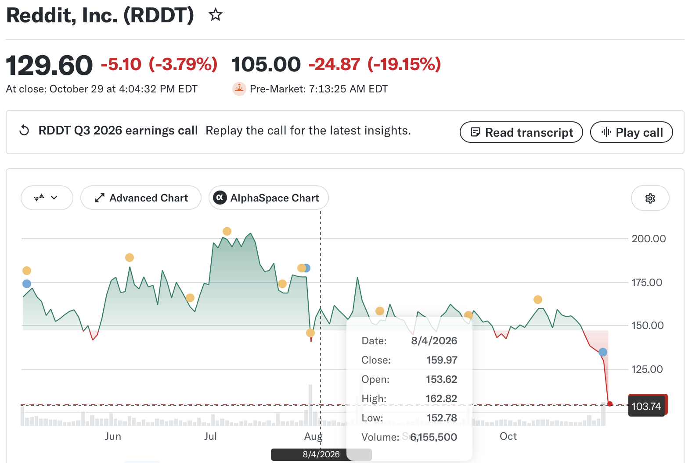

> The grass grows over the graves, time overgrows the pain. The wind blew away the traces of those who had departed; time blows away the bloody pain and the memory of those who did not live to see their dear ones again—and will not live, for brief is human life, and not for long is any of us granted to tread the grass. ―- Mikhail Sholokhov, And Quiet Flows the Don

> And over the village slipped the days, passing into the nights; the weeks flowed by, the months crept on, the wind howled, and glassified with an autumnal, translucent, greenish-azure, The Don flowed tranquilly down to the sea. ―- Mikhail Sholokhov, And Quiet Flows the Don

> The truth may be stretched thin, but it never breaks, and it always surfaces above lies, as oil floats on water. -- Miguel de Cervantes Saavedra, Don Quixote

> When life itself seems lunatic, who knows where madness lies? Perhaps to be too practical is madness. To surrender dreams — this may be madness. Too much sanity may be madness — and **maddest of all: to see life as it is, and not as it should be!** -- Miguel de Cervantes Saavedra, Don Quixote

The pursuit of money above all else has driven these people literally insane, moving things around for the rich to keep them getting richer. It lacks any and all purpose or soul, it is truly hollow. It is behavior encouraged only in a deeply sick, corrupt, inequal society, nothing less.

The name of current cause for stock market movements is AI and debt. But the real reason is reevaluation of stock prices. The scapegoat in the economic downturns could be immigrants. But the real culprit is never named. Why? The disaster of human being is always made by ourselves. But we blame others and call them whatever name that is flying in the air.
 
- “Destiny guides our fortunes more favorably than we could have expected. Look there, Sancho Panza, my friend, and see those thirty or so wild giants, with whom I intend to do battle and kill each and all of them, so with their stolen booty we can begin to enrich ourselves. This is nobel, righteous warfare, for it is wonderfully useful to God to have such an evil race wiped from the face of the earth."

- "What giants?" Asked Sancho Panza.

- "The ones you can see over there," answered his master, "with the huge arms, some of which are very nearly two leagues long."

- "Now look, your grace," said Sancho, "what you see over there aren't giants, but windmills, and what seems to be arms are just their sails, that go around in the wind and turn the millstone."

- "Obviously," replied Don Quixote, "you don't know much about adventures.”

### news

* 2026-10-21: futures are all down slightly Friday, not that big drop like Thursday. Yesterday NVDA down 4.4%. TSM down 4.5%. INTC down 8%. SKHY down 8%. CRWV down 10%. MRNA down 17.6%.
 
* [possible attacks on Iran](https://www.dropsitenews.com/p/iran-war-israel-netanyahu-trump-hormuz-mohsen-rezaei) before [next week’s Israeli elections on Oct 27, 2026, Wednesday](https://en.wikipedia.org/wiki/2026_Israeli_legislative_election)

> The Roosevelt, which departed Japan on Monday, could reach the region by the end of next week ahead of its initially expected deployment slated for late November. It will join the USS George H.W. Bush and USS George Washington, both currently in the Arabian Sea.

> The intersection of Trump’s and Netanyahu’s political interests increases the chances that the war will resume, argues former senior U.S. Iran negotiator Robert Malley.

> Gen. Rezaei is one of the most prominent military figures in modern Iranian history. A former commander of the Islamic Revolutionary Guard Corps, he was tapped to serve as the top military advisor to Khamenei in August. His comments are often viewed as reflecting the consensus at the top of Iran’s power structure. He told Drop Site that despite U.S. claims to have “obliterated” or “decimated” Iran’s military infrastructure, Iran spent decades preparing for a broader war waged by the U.S.

> The senior Iranian official said **Trump’s approach to Iran has been focused on short-term objectives that are often disconnected from geopolitical realities or core U.S. interests, likening him to a day trader**. “The wartime secrecy surrounding military operations has given him and his family exclusive and extraordinary access to information regarding forthcoming actions and the state of the markets—access that benefits only those closest to him,” he said. “Perpetuating the current situation will carry strategic consequences, not least that the energy markets will not find calm for the next three years. The continuation of this war has shifted the dynamics of relations in Iran’s favor, as the littoral states of the Persian Gulf are rapidly redefining their relationship with Iran, having become convinced that the U.S. military is incapable of defending its own bases, this at a time when those same states had expected America to defend their countries.”

### investing

* 2026-10-30: GOOG -13% due to its revenue miss after-market on Wednesday and Thursday. Then INTC -25% from $92 to $68 and AMZN -6% pre-market Friday and both are worse than Thursday after-market. Bitcoin -2500 or -3.1%. (RDDT -21% from $129 to $102. It's $135 a day before. On July 31, 2026 after earning report RDDT down from $180 to $135.) Oil up. Gold down. This is another tech black-day: Nasdaq futures -2.3% pre-market.

* 2026-10-30: use RDDT as an example. The below is its last quarter report on July 30, 2026. On July 31, 2026, down from $178 to $135, the lowest down is about 24% then up a bit. 

* 2026-10-28: Yesterday SKHY +8% after earnings report. Today premarket MU +4%, CRWV +3.8%, TSM +0.45%, UNH -1%, PFE -0.7%. Oil steady above $100. Gold down. S&P futures and Nasdaq futures up, Dow down a bit. Today MSFT and GOOG will report earnings after market. 

* "The plain fact is that inflation is too high and has been for too long," Federal Reserve Chair Kevin Warsh said at his September press conference, after policymakers raised their benchmark rate by a quarter percentage point to 3.75%–4%. And borrowing costs could climb further. Minutes of the Fed's September meeting showed that most participants believed another rate increase "would likely be appropriate by year end." **That could mean another rate hike in December**.

* book: High Returns from Low Risk: A Remarkable Stock Market Paradox by Pim van Vliet, Jan de Koning, 2016
 
### notes

* 

> “自然权利”概念不属于经典的共和主义传统，而是启蒙运动的产物。因此严格来说，美国的建国先贤们是启蒙运动与共和传统的“双轨”继承者：启蒙运动为他们提供了“自然权利”的武器，用以对抗英国王权并为个人自由辩护；而共和主义传统，则为他们注入了警惕政治腐败的危机意识，并贡献了防范暴政的制度设计。美国革命的伟大之处，不仅在于北美殖民地脱离英国独立、建立了一个史无前例的国家，更在于它达成了一次伟大的政治妥协，用一部卓越的宪法，成功地将启蒙运动所倡导的个人权利，植入了经文艺复兴重振的共和主义制度框架之中。（当然，伯纳德·贝林（Bernard Bailyn）会为美国建国的思想资源再加上新教传统，不过那超出了本文的范围。）

> 从这段历史来看，自由在于不被奴役的共和主义理念，的确在英国宪政的确立和美国独立建国的伟业中起到了关键的指导和激励的作用，且一直是占主导地位的意识形态。一个直观的例子：伫立在纽约港口外的自由女神像所礼赞的“自由”，肯定是摆脱奴役获得独立的共和自由。没人会把她解释为是在宣扬个人不被干涉的消极自由。

> 在英国宪政确立和美国独立功成之后，霍布斯在18世纪末就强势回归。他的自由观迅速地取代了共和自由观，成为主流意识形态，以至于到了19世纪，英国所有主要的、且自诩为自由主义者的政治理论家——包括约翰·斯图亚特·密尔、 赫伯特·斯宾塞和亨利·西季威克——都采纳了霍布斯的立场：自由，就其本义而言，就是无外界阻碍的状态。这个政治价值观的大转变，被马克斯·舍恩斯伯格（Max Skjönsberg）称为自由理想的“霍布斯转向”（the Hobbesian Turn）。

> 对于霍布斯转向发生的原因和时机，法国政治家/学者本杰明·康斯坦（Benjamin Constant）在1819年发表的著名演讲《古代人的自由与现代人的自由之对比》中做出了一个说明。康斯坦说的“古代人的自由”，就是指共和自由，而他说的“现代人的自由”，就是霍布斯的消极自由。按照他的说法，共和自由已经不适用于现代社会，其根源在于商业社会的兴起——战争获利下降、私人经济活动的价值上升，使人们不再愿意把大量时间投入政治参与，转而珍视私人生活的安宁与不受干涉。现代人的自由，是建立在个体对私生活的掌控和免于外部干涉之上。

* [bitchat: p2p messaging mesh with bluetooth](https://github.com/permissionlesstech/bitchat)

* 大脑、神经系统和运动

> 大脑里最庞大的系统就是运动系统。可以说，为了精准可控的运动，大脑和神经系统付出了最为高昂的成本，这个成本也许还超越了我们产生感觉和智慧的成本。

> 你想伸手拿一杯水。这个动作的意图产生于大脑皮层：初级运动皮层负责把命令编码成肌肉活动的模式，辅助运动区管动作序列的内部组织，比如弹钢琴这种心里排练出来的动作，前运动皮层负责根据外界线索做准备——看到红灯脚往刹车上挪，就是它在干活。但这里有个关键细节：皮层不是靠单个神经元发号施令的。你想拿水，不是某一个“拿水神经元”在放电，而是一大群神经元同时活动，每个神经元只投一票，票数分布的方向决定手臂往哪走、用多大力、以什么速度。这就是群体编码——分布式、冗余、可容错，天生抗噪声、抗损伤、抗漂移。皮层正是用这种“集体投票”的方式，把意图编码成一个稳定而灵活的运动指令。

> 但皮层说了不算。皮层发出“我要动”的请求之后，要经过基底神经节审批。基底神经节是大脑里的动作选择委员会，有两条著名的通路，直接通路相当于 Go，放行动作，间接通路相当于 NoGo，否决动作。关键在于，基底神经节的输出核团平时是持续兴奋的，像一只手死死踩着下游的刹车。所谓启动一个动作，在神经层面不是踩油门，而是松刹车——直接通路暂时抑制掉输出核团，丘脑和脑干的运动相关核团同时被解除抑制，动作才发生。而基底神经节要选的，正是皮层那套群体编码所表征的动作选项——它不是在选某一个神经元，而是在一组相互竞争的动作表征中，把该放行的放行，把该否决的压住。

> 再往下是脑干。脑干负责那些你不觉得需要思考、但其实一直在算的事：前庭脊髓束根据内耳平衡信号实时调整躯干四肢的伸肌张力，让你不摔倒；网状脊髓束管姿势的粗大调节。更有意思的是中脑运动区——刺激强度不同，动物从站立变成慢走，强度加大变成快走，再加大变成奔跑。上位中枢只给一个分级信号，下面自动切换步态。这是分级驱动，不是逐关节控制。

> 最底层是脊髓。很多人以为脊髓就是一根电缆，这是巨大的误解。脊髓腰段里有中枢模式发生器（CPG）：一组能自动产生节律的神经元网络。你决定“走”之后，腿的屈伸交替、左右交替，全部由脊髓里的中间神经元自动完成，不需要大脑逐拍指挥。去大脑的猫在跑步机上能走出相当正常的步态，靠的就是它。脊髓里还有牵张反射：肌肉被意外拉长，信号在脊髓内一个突触就触发收缩修正，毫秒级完成——这是全身最快的反馈系统，因为它根本不请示大脑。运动神经元的募集还遵循大小原则：小的先上，精细省电；大的后上，只在需要大力时加入。这是神经系统内置的能源管理。

> 单独说一下小脑。基底神经节负责“选哪个动作”，小脑负责“这个动作做得好不好”——它管的是协调、时序和误差校正。临床上的对比很清楚：基底神经节坏了，是启动困难、动作选不出来；小脑坏了，是动作能做出来但做不流畅，目标是拿到了，路径却歪歪扭扭，或者多个关节配合得七零八落。

* 阿谅：在那个野蛮生长的年代（1993—1997） 

> 选择一个行业，不仅要考虑自己能不能胜任工作，还要考虑这个行业将来能不能让自己独立创业。我需要寻找的，不仅是一份工作，更是一个能够依靠自己的专业技术独立谋生、进而建立事业的行业。为什么选择电梯，而不是与我专业相关的其他专业，如汽车或工程机械？汽车制造是典型的大工业，生产需要庞大的厂房、设备、资金和供应链。对于一个没有资本、没有社会关系的年轻工程师来说，即使掌握了一定的技术，也很难独立创业。而且，汽车是移动的产品，售后服务体系分散，个人很难建立稳定的服务业务。

> 电梯却完全不同。首先，电梯是固定安装在建筑物里的设备。只要建筑物存在，电梯就需要长期运行、定期维护和修理。其次，电梯是一种机械与电气高度结合的机电设备，具有较高的技术门槛。这正好符合我的专业背景，也符合我此前积累的机械维修和电气控制经验。第三，电梯具有长期、持续的维护需求。保养费按月收取，只要拥有一定数量的维保合同，就能够建立稳定的经常性收入。最后，电梯属于具有特殊安全要求的专业行业，而且工作条件艰苦，并不是任何人都可以随便进入。专业技术能力本身就是重要的竞争优势。在我看来，这个行业具有一个非常吸引人的特点：它的技术门槛很高，但个人创业所需要的初始资本，却不高。我不需要自己建造一家电梯制造厂，也不需要生产整台电梯。只要掌握电梯的安装、维修和保养技术，逐步建立客户关系，就有机会从几台电梯的维护业务开始，发展自己的事业。这与我在打包机行业积累的经验非常相似。设备销售可能是一次性的收入，而设备维护却可以带来长期、稳定的业务。所以，在看到创发电梯公司的招聘广告时，我很快就作出了决定：我要进入电梯行业。

> 彭继兴的经营方式与我不同。他更重视与客户之间的关系，也愿意为了获得业务而提前付出较大的代价。从这一点上，我第一次体会到，技术人员与销售人员在经营思路上确实存在明显差异。

> 我的优势是技术，是判断电梯故障、组织维修、解决现场问题，并用可靠的服务赢得客户信任。至于整梯销售，从报价、订金、合同履行到最后收款，每一步都可能牵涉远远超过我个人控制能力的资金和商业关系。连几十万元的订金如何处理，我都无法掌握，何况整个销售合同的风险？我主要做电梯维修保养，尤其是自己熟悉、质量可靠的进口电梯。自己不愿意承接的低价维保业务，我可以介绍给彭吉兴；他有自己的维修人员和经营方式。我需要公司合同和票据方面的支持时，再与他合作。我们不是凡事混在一起的合伙人，而是各有所长、彼此借力的经营伙伴。这也成为我后来反复坚持的一条原则：一个人应当清楚自己的长处，更应当知道哪些事情不适合自己做。

> “做技术就从修理开始，做生意就从销售开始“。

> 1994年，我决定进入电梯行业，一个重要理由就是电梯与汽车不同。电梯固定在一栋建筑里，安装以后就需要长期保养。只要服务做好，便可能获得稳定、持续的业务。这是我当年看中电梯行业的根本原因之一。这个判断并没有错。正是靠着一台又一台固定在珠海的电梯，我建立起每月相对稳定的维保收入，也因此有能力独立生活。可是，当珠海市场开始走下坡路，我才发现：同一个特点，也可以从优势变成劣势。电梯固定不动，意味着我的客户和收入也被固定在珠海。我可以带着技术回青岛，可以去上海重新发展，却不可能把已经签下维保合同的电梯一起带走。若要在另一个城市重新开始，就必须重新建立客户关系、寻找业务、安排维修服务。留在珠海，市场又在变化；离开珠海，原有的业务基础便很难带走。我陷入了进退两难的境地。那时候，我常用一个比喻来形容自己的经营模式：一个老太太在家里养了几只鸡，每天靠鸡下蛋，便可以维持生活。我手里的那些电梯，就是我的几只老母鸡。每台电梯每个月交一点保养费，积少成多，足够我们过上不错的生活。可是鸡终究会老，会死，也可能遇上鸡瘟。如果哪一天这些鸡都不下蛋了，我这个“老太太”可怎么办？我的电梯维保业务也是如此。客户可能更换维保公司，设备可能被拆除或更新，建筑可能改变用途，市场价格也可能下降。事实上，后来我的收入已经不像1996年那样增长，有时一年反而少上一万元左右。虽然现有业务仍足以维持生活，但我清楚地感觉到，这种模式的增长空间越来越有限。

> 2000年10月，我偶然看到一则赴英国留学的广告。这个机会一下子吸引了我。我很快着手申请，并顺利取得录取通知书。2001年2月，我拿到了英国签证。到了同年4月，我离开中国，来到英国，开始人生和职业生涯的新阶段。来英国留学，也是我完全独立申请的，真正花费只是三百多人民币的签证费。

> 我已经是国际上有点小名气的电梯和电扶梯专家和世界级的垂直交通顾问。
* [Apple. "Think different" Ad on September 28, 1997](https://en.wikipedia.org/wiki/Think_different) 

> Here’s to the crazy ones. The misfits. The rebels. The troublemakers. The round pegs in the square holes. The ones who see things differently. They’re not fond of rules. And they have no respect for the status quo.

> You can praise them, disagree with them, quote them, disbelieve them, glorify or vilify them. About the only thing you can’t do is ignore them. Because they change things. They invent. They imagine. They heal. They explore. They create. They inspire. They push the human race forward. Maybe they have to be crazy.

> How else can you stare at an empty canvas and see a work of art? Or sit in silence and hear a song that’s never been written? Or gaze at a red planet and see a laboratory on wheels? We make tools for these kinds of people.

> While some see them as the crazy ones, we see genius. Because the people who are crazy enough to think they can change the world, are the ones who do.

* [陈家丽, 1956, 台湾作词人](https://zh.wikipedia.org/zh-hans/%E9%99%B3%E5%AE%B6%E9%BA%97)

> 苏芮: 跟著感觉走

> 张雨生: 我的未来不是梦

> 张雨生: 和天一样高

> 张信哲: 爱就一个字

> 张信哲: 用情

> 庾澄庆--让我一次爱个够 

> 苏慧伦，杜德伟：爱你让我勇敢

* [meatloaf, serial communication for C64](https://github.com/idolpx/meatloaf)

> hackaday page: https://hackaday.io/project/180051-meatloaf

* [book: Secondhand Time: The Last of the Soviets, by Svetlana Alexievich](https://en.wikipedia.org/wiki/Svetlana_Alexievich)

> Svetlana Alexievich, 1962-, Belarus. the first journalist to receive 2015 Nobel Prize.

> Death is the fairest thing in the world. No one's ever gotten out of it. The earth takes everyone - the kind, the cruel, the sinners. Aside from that, there's no fairness on earth.

> No one had taught us how to be free. We had only ever been taught how to die for freedom. (we know the struggle, the suffering and the unhappiness well. we could say the same for happiness here as freedom.)

> “We're often silent. We don't yell and we don't complain. We're patient, as always. Because we don't have the words yet. We're afraid to talk about it. We don't know how. It's not an ordinary experience, and the questions it raises are not ordinary. The world has been split in two: there's us, the Chernobylites, and then there's you, the others. Have you noticed? No one here points out that they're Russian or Belarussian or Ukrainian. We all call ourselves Chernobylites. "We're from Chernobyl." "I'm a Chernobylite." As if this is a separate people. A new nation.” -- Svetlana Alexievich, Voices from Chernobyl: The Oral History of a Nuclear Disaster

> “Happiness is beyond the mountains, but grief is just over the shoulder” -- Svetlana Alexievich, War's Unwomanly Face

> “Let time be the judge. Time is just, but only in the long term—not in the short term. The time we won’t live to see, which will be free of our prejudices.” -- Svetlana Alexievich, Secondhand Time: The Last of the Soviets

* 渔魂王：狂钓鱿鱼

> 在北卡罗来纳州钓到的棍子鱼whiting（也被称为northern kingfish或southern kingfish）没有尖牙，其实与美国大黄鱼或鼓鱼属于同一大家族；而我在罗德岛钓到的whiting则长着尖牙，纯属鳕鱼家族的一员。真正的名字应该是无须鳕鱼，英文为：Atlantic hake或silver hake。
 
* Malva sylvestris

* [《跨越栅栏》每个丧逼，都该找个丧友相爱](https://m.wufazhuce.com/movie/577)

> 《跨越栅栏》改编自41岁时自杀的作家[佐藤泰志](https://ja.wikipedia.org/wiki/%E4%BD%90%E8%97%A4%E6%B3%B0%E5%BF%97)的同名小说，佐藤泰志本人曾5次获得芥川文学奖的提名。

* [the review on **Gil Duran's book "The Nerd Reich"**](https://unwall.app/www.nybooks.com/articles/2026/11/05/the-plot-to-delete-democracy-nerd-reich-duran/)

> "Kushner’s apparent betrayal of the public trust, however, went further than his failure to disclose the secret Alpha account in the UAE or the Beta account in Israel. By giving him access to roughly $2 billion, regardless of how the money was used, MBZ and MBS were paying for his influence within the US government. Any efforts he made to shape US policy that came from a foreign government that had provided him with money would make him an agent of a foreign power. US law requires citizens who lobby on behalf of a foreign power to declare themselves and the country they are working on behalf of to the Justice Department."

* 方舟子: 为什么年轻人得癌症的越来越多？

> 不只是结肠癌、乳腺癌早发型的病例越来越多，至少有十几种癌症都发现有年轻化的趋势。现在年轻人衰老得快了。同样岁数的人，为什么有人显得老，有人显得年轻呢？那就是因为他们的生物年龄是不一样的。

> 癌症年轻化这个现象只是在一两代人、两三代人之间发生的，在这么短的时间内，遗传因素是不可能发生变化的，基因突变的速度没有那么快。所以这个现象肯定是由于环境因素导致的。其中一个因素是吃得多了导致肥胖、体重超标。另一个因素年轻一代活动少了，久坐多了。还有一个因素，饮食改变，年轻一代从小吃了很多超加工食品。当然还有其他因素。

> 不抽烟，少喝酒，控制体重，多锻炼，多吃水果蔬菜，不吃中药

* 方舟子: 人形机器人除了玩杂耍还能干什么？

> **进化是不会追求至善至美的，自然选择是机会主义者，在原来的基础上修修补补能用就凑合着用了**。在进化过程中，往往要根据需要做出妥协、权衡、交换、牺牲。如果我们仔细看人体各种各样的构造，就会发现设计得非常糟糕，里面有一大堆很蹩脚的错误设计。由一个人类工程师来对人体重新进行设计，可以设计得更好。如果人体是智能设计出来的，绝对不会出现一大堆那么烂的设计。这是人是进化而来的一个最强的证据，说明人体不是神或智能设计出来的，否则不会出现这么多蹩脚的设计。

> 比如说人的一个特征是直立行走，用两只脚走路，但是这样带来的一个结果是：跑不快。
跑得再快，也没有四条腿的跑得快。四条腿的跑得再快，也没有轮子跑得快。所以两条腿其实是不适合奔跑的，也跑不稳。而且直立行走带来了一个问题，让人体的脊椎很脆弱，这就是为什么人很容易得各种各样的脊椎的毛病，椎间盘突出之类的，是四条腿走路的动物不会得的疾病。也让人体负重能力很差。

> 所以人用两条腿走路，不是一个很好的设计。那为什么人会从四条腿走路变成了两条腿走路呢？这是为了将两只手解放出来，不得不做出的权衡。我们需要用上肢来干别的事情，比如说需要用它来抱婴儿，因为人类的小宝宝跟灵长类的是不一样的，是完全无助的，必须用手抱着它。人类还要将双手解放出来使用工具。所以为了能够将手解放出来，只好选择直立行走。这是一个可能的原因，可能还有别的原因，但不管怎样，直立行走是为了别的好处而不得不做出的牺牲，而不是两只脚行走要比四只脚行走要好。

> 为什么不能进化出来，保持四只脚行走，但是再长出两只手出来来抱小宝宝、使用工具？因为生物的进化会受到各种各样的制约，包括受到历史的、发育的制约。脊椎动物的祖先一开始就已经走上了四肢这条路了，没法凭空再进化出二肢出来变成了六肢的动物。

> 由于人体不是智能设计出来的，而是盲目进化出来的，所以人体有很蹩脚的设计，当然也有非常优良、精致的设计。比如说，人的手，在生物界是无与伦比的灵巧的。但是，再灵巧的手，也比不过精密仪器。

> 人体里最精致、最优秀的设计，是人脑。正是因为人类有一个无与伦比的大脑，有非常高的智能，所以能够打败比我们强壮得多、跑得快得多、凶狠得多的其他生物，成为了世界的统治者。

* 房向东: 短命的鲁迅

> 鲁迅不求长寿，“赶快做”是他经常说的话。有的人活着，他却已经死了；有的人死了，他却仍然活着。鲁迅是短命的，然而，他却是永恒的。

* HRT Gang: Alexandr Wang @ Meta AI, Scott Wu @ Cognition (Devin), Jeff Yan @ Hyperliquid, all are interns at Hudson River Trading around 2015. 全球四大半导体巨头由华裔统领 -- 英伟达的黄仁勋、AMD的苏姿丰、博通的陈福阳、英特尔的陈立武，牢牢掌控着全球GPU与定制AI芯片的供给命脉。

* [Paypal Mafia](https://en.wikipedia.org/wiki/PayPal_Mafia): LinkedIn, Palantir Technologies, SpaceX, Affirm, Slide, Kiva, YouTube, Yelp, and Yammer.[2] Most of the members attended Stanford University or the University of Illinois Urbana-Champaign.

* book October 2026: Charlemagne’s Dream: The Rise and Fall of the Carolingian Empire, by James T. Palmer 

* [PHP2Shellvulnerabilities](https://en.wikipedia.org/wiki/PHP2Shell)

* Saigon was renamed to Ho Chi Minh city after the Vietnam war. Its geography is defined by rivers and canals, of which the largest is the Saigon River.  It was also the capital of French Indochina from 1887 to 1902, and again from 1945 until its cessation in 1954.

* [Graham Greene, 1904-1991, English writer](https://en.wikipedia.org/wiki/Graham_Greene): The Quiet American, about Vietnam. The Honorary Consul. Journey without maps, about Liberia.

> The sense of unhappiness is so much easier to convey than that of happiness. In misery we seem aware of our own existence, even though it may be in the form of a monstrous egotism: this pain of mine is individual, this nerve that winces belongs to me and to no other. But happiness annihilates us: we lose our identity.

> Writing is a form of therapy; sometimes I wonder how all those who do not write, compose, or paint can manage to escape the madness, melancholia, the panic and fear which is inherent in a human situation.

* [book: Open Veins of Latin America, a 1971 book written by Uruguayan journalist, writer, and poet Eduardo Galeano that analyzes the impacts of European settlement, imperialism, and slavery on Latin America.](https://en.wikipedia.org/wiki/Open_Veins_of_Latin_America)
