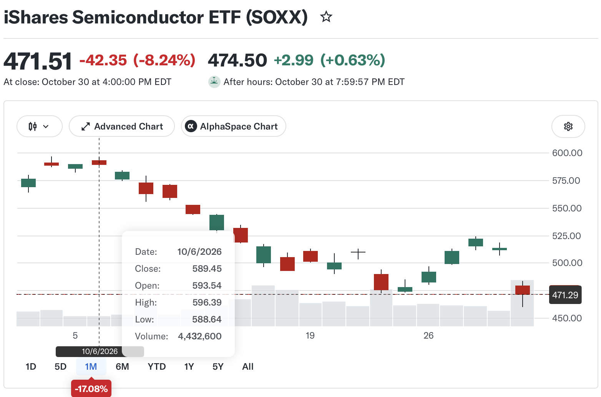

* 黄河远上白云间，一片孤城万仞山。

> 君不见，黄河之水天上来，奔流到海不复回。君不见，高堂明镜悲白发，朝如青丝暮成雪。人生得意须尽欢，莫使金樽空对月。天生我材必有用，千金散尽还复来。-- 李白《将进酒》

> 你只要看看世界，只要把眼光放大，眼光一放大，许多问题就不成其为问题了，**中国今天的问题是很多人没有看到世界**。-- 周有光

* [A New World (from "Final Fantasy V") - Nobuo Uematsu](https://bsky.app/profile/tristanbouchard.bsky.social/post/3mzidaisfhc2b). [youtube](https://www.youtube.com/watch?v=vFREtmOFa1k)

* forced freedom: the freedom we inherited is the forced freedom, the right given instead of earned and fighted. the space is there but the boundary of freedom is very blurred without fighting. to make it clear, explore it, expand and extend it.

* trespassing rabbit: a rabbit was killed while crossing the road by a car. it went straight up to the heaven to complain to the god. "we rabbits live on the earth for a very long time but nowadays we are often killed by the vehicles. but we have the right to roaming around, right?"

### news

* tephra, n. solid matter that is ejected into the air by an errupting volcano. [Hawai'i Kīlauea Volcano is still fountaining inside Halema’uma’u Crater.](https://bsky.app/profile/hawaiipacificparks.bsky.social/post/3mzmdrl7zz224) 

* 2026-11-06: New employment data released Friday at 0830AM is expected to show a labor market that's holding steady. **US adds 165K jobs in October, est. 70K.** The premarket rebound of chip stocks after a $2.3T brutal selloff yesterday. 

* **2026-11-05 brutal Thursday**: Yesterday the markket starts re-evaluation after the mid-term election. Both AI-related and semicon-related stocks down. Oil is down. Gold is up. All others are up. Today the overall market down. All indice are down, Dow -3.4% or more than 1800 points, S&P500 -4.3% or more than 300 points, Nasdaq -5.5% or more than 1400 points, Nasdaq100 -6.3% or 1800 points. SOXX -12% or -$18. Oil price up.

* 2026-11-04: Markets swiftly repriced a Democratic sweep of the House and Senate — and the potential for ballot measures and newly elected officials **to restrict data center construction**. AMD (AMD) stock fell slightly following the company's Q3 earnings beat. Chip stocks, including Nvidia (NVDA) and Micron (MU), fell more than 1%. TSM down a bit. **DOUL +35%** on user growth and upbeat guidance. Investors will also be watching for actions on housing and pharmaceuticals in the aftermath of the election.

* Apple beats Q4 estimates on strong iPhone sales but misses on China revenue.

* The biggest AI and chip stocks have shed about $5 trillion in market value since Oct. 6, by Yahoo Finance calculations. Nvidia (NVDA) and Alphabet (GOOGL) have each given up roughly $835 billion in market cap, and Intel (INTC) lost nearly half its value in October.

* The iShares Semiconductor ETF (SOXX) tumbled about 17% in October, yet it's still up more than 50% this year. On Friday, it dipped as low as $460, below the $464 low from July 29 that marked this summer's bottom. Then it closed at $472, back above that line. 

* 费城半导体指数收跌7.2%，创6月以来最大跌幅。费城半导体指数（SOX）是衡量半导体行业整体景气度的核心指标，追踪30家头部半导体企业的股价表现。INTC -28.58%. QCOM -11.1%. AMD -10.9%. ARM -9.97%. CRWV -9.66%. SKHY -7.95%. TSM -5.95%. AVGO -5.5%. MU -5.3%. NVDA -4.2%. AI. debt. oil. inflation. mid-term election on Nov 3. AAPL, AMD, PLTR earnings next week.

* case: TSM

| date | ref | low | high | open/close(%) | delta | notes |
| ---- | --- | --- | ---- | ------------- | ----- | ----- |
| 26/10/05 | | 476.40 | 487.47 | 478.77/486.80 | | peak, 11M |
| 26/10/15 | | 407.13 | 423.66 | 416.17/422.25 | | Q2'26, 22M |
| 26/10/16 | 422.25 | 410.58 | 421.50 | 421.22/412.61 | -10 | down with beating result, 17M |
| 26/10/21 | 422.25 | 423.74 | 435.16 | 433.14/431.89 | +10 | peak, 11M |
| 26/10/22 | 422.25 | 410.22 | 421.91 | 419.39/412.35 | -10 | valley, 16M |
| 26/10/28 | 422.25 | 436.84 | 440.88 | 438.24/439.51 | +20 | peak, 8M |
| 26/10/30 | 422.25 | 400.12 | 418.09 | 414.08/406.13 | -20 | valley, 22M |
| 26/11/02 | 422.25 | 398.29 | 414.76 | 412.52/398.53 | -20 | valley, 13M, hold |

* case: INTC

| date | ref | low | high | open/close(%) | delta | notes |
| ---- | --- | --- | ---- | ------------- | ----- | ----- |
| 26/09/24 | | 119.55 | 127.44 | 120.61/127.39 | | peak, 119M |
| 26/10/28 | | 93.00 | 95.68 | 95.06/95.53 | | valley, 82M |
| 26/10/29 | | 90.84 | 93.50 | 92.97/92.07 | | Q2'26, down, 134M |
| 26/10/30 | 92.07 | 63.20 | 68.77 | 68.36/65.76 | -30, 454M |

* case: GOOG

| date | ref | low | high | open/close(%) | delta | notes |
| ---- | --- | --- | ---- | ------------- | ----- | ----- |
| 26/10/28 | | 319.68 | 323.13 | 319.88/321.89 | | Q2'26, 35M |
| 26/10/29 | 321.89 | 278.29 | 286.43 | 283.84/282.32 | -40 | -13%, 93M | 
| 26/10/30 | 321.89 | 275.35 | 281.86 | 279.69/278.22 | -40 | even, 45M |

* case : CRWV

| date | ref | low | high | open/close(%) | delta | notes |
| ---- | --- | --- | ---- | ------------- | ----- | ----- |
| 26/08/11 | | 87.46 | 93.60 | 90.94/90.32 | | earning, 46M |
| 26/10/06 | | 88.60 | **93.21** | 88.60/91.72 | | peak, 32M |
| 26/10/23 | | **54.01** | 56.11 | 54.92/54.24 | | valley, 47M |
| 26/10/28 | | 58.55 | **64.02** | 60.55/63.93 | | peak, 62M |
| 26/10/29 | | 60.11 | 64.39 | 61.18/60.74 | | down, 47M |
| 26/10/30 | | 53.48 | 56.90 | 56.12/54.87 | | down, 53M |

* After the selloff of yesterday, it is clear that PFE, UNH, and NFLX are on one side, and AI and semicon are on the other side of market preference. Oil is another sector.

### notes

* 徒步的骑手：从世界看中国 

> 周有光发明了汉语拼音，被称为“汉语拼音之父”。

> 周有光先生晚年功成名就，为什么他专门嘱咐中国的年轻人，要学会从世界看中国，不要局限于从中国看世界？一个简单的答案就是，因为中国是个打造了无数代人的笼子，是一口挖了无数代人的井，从里面往外看，看不到真实的世界，只能看到笼子后面的世界，只能看到井口下面的世界。

> “要从世界看中国，不要从中国看世界”，这可以说是一场中国人认知的“哥白尼革命”。在哥白尼之前，人们却相信是太阳绕着地球转。这就是流行了1500年的“地心说”——地球是宇宙中心，太阳、月亮、所有行星和恒星都围绕地球运转。“地心说”之所以流行，并不是偶然的。它既符合古代人对太阳东升西降的直觉，也符合天主教神学上帝创造世界、创造人类的教义。这种世界观，就像中国人流行了2000多年的“天下中心论”一样，把自己周围的空间当成世界中心，当成永恒不变的唯一参照物。

> 1543年，相当于中国明朝嘉靖年间，离满清入关，明朝覆灭还有一百年。那一年，波兰人哥白尼出版《天体运行论》，提出“日心说”。根据科学观测，他发现，不是太阳围绕地球转，而是地球围绕太阳转；地球只是无数颗行星中的一颗，它跟其他行星一样，都在围绕太阳公转，同时地球也在自转。这就是哥白尼革命。之所以，叫做“革命”，是因为它的颠覆性认知：它彻底动摇了人类自我中心的虚假定位。从此，人类的视野就从一个封闭、有限的静态宇宙，转向了一个无限、广阔的动态宇宙。这正是从“坐井观天”到“海阔天空”的认知飞跃。

> 周有光先生的智慧，对于当代中国人认知世界的意义，类似于哥白尼革命，他把观察的立足点，从自我中心，也就是从“中国中心”移开，放到一个更广阔的“世界”背景中。有这种眼界，才能真正看清中国在世界上的真实位置和它的“自转”规律。

> 把中国放到这个完整的坐标中，才能准确定位，才能看清中国的现状和未来走向。周先生从三个方面梳理了这架文明坐标的纵轴。第一个方面，就是经济：人类文明大致经历了从农业化到工业化，再到信息化的进程。第二个方面，就是政治：人类文明经历了从神权政治到君权政治，再到民权政治的进程，从独裁专制到宪政民主，这是文明发展的大趋势。第三个方面，就是思维和认知，用周先生的话说，是从神学思维到玄学思维，再到注重实证和逻辑的科学思维。

> 季羡林: 《留德十年》

> 文化是流动的，就像河里的水一样。他说：“文化流动，不是忽东忽西，轮流坐庄，而是高处流向低处，落后追赶先进。这样，人类文化才能不断前进。”

> 现代文明中有很多平日看似没用的东西，像保险一样，只有在非常状态下才用得着，但大部分中国人觉得自己比欧美国民更聪明，**只弄平日有用的**，房子、车子、票子、地位、职称，做人上人，至于德性、权利、自由、同情同理心等都没用，欧美国民追求那些东西都是傻帽。**中国人这种小聪明成了中国的宿命**，一代一代人地在亚文明状态周而复始，走不出那个鬼打墙的闭环。

* 徒步的骑手：戒断中国？ 

> “如人饮水，冷暖自知”，这种感觉，不是“中国情怀”这种高大上词汇可以概括的。要用词语来描述这种感觉，总会言不尽意。余英时讲了一个佛经上的故事。有只鹦鹉，飞过一座山，看到山中有大火，它扑到水中，把翅膀打湿了，再飞到失火的山上，把水滴扑洒到火上。但鹦鹉翅膀上的几滴水，怎么能扑灭山中的大火呢？天神看到了，就对鹦鹉说：“你虽然有灭火的意志，但有什么用啊？”鹦鹉说：“**我以前住在这座山中，不忍心眼看着它让火烧了**。”天神受到感动，就把火扑灭了。“屡次自戒，而终不能绝”

> 我在中国生活了三十多年，在美国生活了二十多年，直到今天，我也没能搞清楚“中国的主流社会”是什么，“美国的主流社会”是什么。人，从来不是生活在一个想象的、宏大的“主流”叙事中。人是活在具体的社区、具体的职场、具体的朋友圈和兴趣爱好圈子中。我们跟周围活生生的人能不能和谐相处，能不能彼此认同，相互成人之美，才是衡量我们有没有归属感的现实标准。在日常生活圈子中有归属感，谁还有闲工夫去给自己设个“主流社会”的语言陷阱，跳进去顾影自怜呢？

> 让一个人能交到朋友的那些美好品行，比如心灵开放、真诚、善良、乐于助人，在任何社会、任何文化中都是畅通无阻的硬通货。相反，一个心灵封闭、自私自利、价值观落后、不懂得尊重他人的人，不但在美国交不到朋友，在中国也交不到朋友。这不是文化差异问题，这是个人性格、个人价值观、个人为人处世的问题。用一句话概括，这是个人问题，跟文化不相干。看到问题的结症，就会明白，我们到了一个新环境，却把自己包裹起来，不愿放下那点可怜的虚荣去虚心学习，不愿主动向周围的人释放善意，就不会有朋友，就会感到孤独，就会有一种被排斥感。为了维持自尊，维持虚荣心，人会本能地向外找原因，想象出一个排斥自己的、高高在上的“主流社会”。这是一种非常典型的心理防御机制。一旦这种心理防御机制被激活，个人成长的窗口就关闭了。

> 我们在人生中途，移民到一个新的国家，真正的融入，真正的归属感，不是来自这些浮皮潦草的东西，面是来自**价值观的认同和人性的共鸣**。在美国，融入不是融入白人，而是融入美国的现代文明价值观，融入“美国信条”，融入自由的生活方式。这跟肤色、跟口音、跟爱好哪一种体育活动，都没有关系。现代文明价值观、现代文明生活方式，有些最基本的原则，比如说，契约精神、遵守规则，懂得权利与义务的边界；尊重他人，不管他的种族、信仰、性取向如何，**承认每个人都是独立的、平等的；珍视自由和个人权利；具备公德，关心社区事务，愿意为公益做出奉献**；再比如，**要具备批判性思维，不盲从权威，能够独立思考，按照事实做出判断**。**这些现代文明人的品质是不分国界的**。在美国，认同现代文明价值观，践行现代文明价值观，是跟邻居、跟同事之间沟通的基础，也是交朋友的基础。一旦有了有效沟通，一旦有了朋友，人自然会有融入感，会有归属感。

> 不管是在墙内，还是在墙外，先抛弃精神世界的“墙”和“井”，把那些浮皮潦草的东西放到一边，做个有现代文明价值观的自由人。生活世界的常情常理都是相通的，在为人处世方面，美国跟中国没有多大差别，都是人同此心，心同此理。我们不需要“戒断中国”，我们需要“戒断”的是中国强加给我们的**“墙”和“井”**。所谓融入，无非如此。

* [Led Zeppelin, Immigrant Song](https://en.wikipedia.org/wiki/Immigrant_Song)

* [Möbius strip](https://en.wikipedia.org/wiki/M%C3%B6bius_strip)

* [Carrie Fisher, 1956-2016, Princess Leia, Star War](https://en.wikipedia.org/wiki/Carrie_Fisher)

* [方舟子: 刘欢之死和音乐的作用](http://xys.org/xys/netters/Fang-Zhouzi/kexueshijie/music.txt)

> 音乐有没有用呢？音乐当然有用，即使是实际的用途，也很多。**音乐实质上是一种语言**，是一种普适的语言，而且是一种非常强大的语言，能够打动人心。由于它能够打动人心，那么就是一种很好的宣传手段。这就是为什么所有的国家都有国歌，军队都有军乐、战歌，宗教有赞美诗、颂歌、圣歌，共产党有革命歌曲、红歌。这些都是要利用音乐作为宣传手段。

> 音乐能够打动人心，那么就是一种很好的沟通、交流、互动的手段，可以增进归宿感、认同感。所以乐队或合唱团的成员彼此之间的关系都很密切。你要把人召集来，一个简单的方法是开音乐会，大家也就都来了。由于音乐能够打动人心，所以它也是一种很好的求偶手段，这就是为什么有那么多的情歌。对此生物不同物种是共通的，其他会唱歌的动物也是这样。很多种鸟的鸣叫都很动听，本质上也是一种音乐，那可不是为了让人听着好听，就是为了求偶。

> 音乐对于人的身心健康会有很大的作用，特别是器乐，作用要比声乐大得多。音乐对于人脑的刺激是多方面的，能够刺激人脑跟情感、记忆有关的区域。器乐还能够刺激到运动皮层，特别是演奏器乐。大脑是一个可塑性非常强的器官，受到的刺激越多，就越容易形成各种各样的神经回路。所以小孩如果从小学音乐，受到长时间的音乐的刺激，就会让大脑变得发达，增强他的认知能力、记忆能力，也就是通俗说的，变得更聪明。我们这里学校的音乐老师喜欢说，乐队的学生学习都很好，跟体育队的学生不一样。

> 成年人如果喜欢音乐，不会因此变得更聪明了，但是能够防止认知能力、记忆能力的衰退，预防老年痴呆。音乐也可以用来治病。现在流行的音乐疗法，对于某一些疾病，包括老年痴呆、帕金森病、慢性疼痛，都有一些治疗效果，至少能够改善生活质量。音乐能够刺激大脑分泌多巴胺、内啡肽、5-羟色胺，这些神经递质都能够让人产生愉悦感、精神放松、平静，就能够减少焦虑、精神压力、抑郁。音乐还能够刺激大脑分泌催乳素，这是一种“爱的激素”，能够增进感情。

* [方舟子: 得诺奖的分子手性研究是怎么回事？](http://xys.org/xys/netters/Fang-Zhouzi/kexueshijie/handness.txt)

> 首先说一下什么是手性。手性当然跟手有关。大家看右手和左手，看上去是很像的。但是你没法把左手和右手重叠在一起，一个最明显的区别，大拇指的方向是不一样的。这就是为什么右手戴不了左手的手套，左手也戴不了右手的手套。但是为什么左手和右手看上去很像呢？那是因为它们具有镜像对称性。将右手照镜子，镜子里的右手就可以跟左手重叠了。用化学术语来说，左手和右手构成了对映异构体。

> 为什么会有这个化学术语呢？那是因为很多化学分子也存在着手性。这是法国伟大的科学家巴斯德发现的。巴斯德在很多科学领域都有重大的发现，包括生物学、医学、化学、食品工艺等等。那个时代没有诺贝尔奖，否则巴斯德拿诺贝尔奖可以拿得手软。巴斯德在化学上的最重大的发现，就是发现了分子有手性。

> 他是通过研究酒石酸发现的。酒石酸是葡萄发酵酿酒时产生的一种酸。在巴斯德之前，已经有法国科学家研究过酒石酸，发现用偏振光照射酒石酸的溶液，光线会往右旋。酒石酸可以通过化学反应来合成。但是，化学合成的酒石酸，如果用偏振光来照，光线就没有发生旋转。

> 为什么生物来源的酒石酸和化学来源的酒石酸有不同的旋光性呢？它们的化学性质、其他物理性质都是一样的。巴斯德对这个问题很感兴趣。他将化学合成的酒石酸结晶变成了晶体，在显微镜下看，发现有两种晶体，是互为镜像对称的。他将这两种酒石酸的晶体分开，做成了溶液，用偏振光分别照它们，发现有一种光线是往右旋的，有一种光线是往左旋的。由于化学合成的酒石酸，右旋的和左旋的对映异构体含量是相等的，混在一起用偏振光去照，旋转方向互相抵消，被消旋了。但是生物合成的酒石酸，只有右旋的酒石酸，光线才表现出转动。

> 巴斯德的这个发现很重要，它表明：第一，化学分子是会表现出手性的，有左旋的和右旋的之分。第二，生物产生的化学分子对手性有偏好，只产生了一种手性的分子，叫做手性同质性。不只是酒石酸是这样的，很多生物分子也是这样。最明显的是氨基酸，生物产生的氨基酸基本上都是左旋的（个别有右旋的，我们忽略不计了），但是如果是化学合成的氨基酸，那么就同时产生左旋的和右旋的氨基酸，量是一样的。还有，DNA上面有糖分子，都是右旋的。

* [方舟子: 光遗传学是怎么来的？](http://xys.org/xys/netters/Fang-Zhouzi/kexueshijie/optogenetics.txt)

> 很多单细胞的生物，包括细菌、古菌、真菌，都有对光敏感的蛋白质。这次诺贝尔奖获得者中有一个是德国的黑格曼，他研究的是一种绿藻。绿藻为什么是绿色的？因为有叶绿素。叶绿素要进行光合作用，就需要有光。这种绿藻有趋光效应，哪里有光就往那里游过去，它上面有鞭毛可以游动。为什么它能够有趋光效应？因为这种绿藻虽然是单细胞的，但是有一个像眼睛一样的眼点，眼点中有能够感光的蛋白，叫做视紫红质。人类的视网膜能够感光也是因为有视紫红质。
 
> 黑格曼的研究发现，如果用光刺激绿藻的眼点，里面的视紫红质就会将细胞膜的通道打开，带正电的阳离子就会从这个离子通道流入细胞，形成了电流，给鞭毛带来了能量，鞭毛得以摆动，绿藻就往光的方向游了。

> 黑格曼还去测了一下从光刺激到绿藻产生反应需要的时间长短。测的结果发现，起反应的时间极短，只要0.5毫秒。这个反应速度是极快的，跟人的眼睛视网膜做一个对比就知道了。用光刺激视网膜的视紫红质，它也会产生电信号传到大脑，我们才能够看到图像。但是这个过程需要10毫秒，是绿藻的反应时间的20倍。

> 为什么人的视紫红质从感光到产生电信号的反应时间要这么长呢？这是因为视网膜里的视紫红质感受到光之后，跟一系列的蛋白质发生反应，最终才产生电信号，需要的时间就比较长了。黑格曼推测绿藻的视紫红质反应那么快，是因为它自己就能够产生电信号，不需要再借助别的蛋白质。也就是说这是一种很特殊的光敏蛋白。他就想把这种蛋白质纯化出来。但是绿藻的这种蛋白质非常脆弱，很难纯化。黑格曼实验室花了十年的时间都不成功。

* 余茂春：到底是谁伤害了中国人民的感情？

> 毛泽东搞大跃进，造成一场人类历史上最严重的人为大饥荒，估计有三千万到四千五百万中国人因此丧命。 接着又搞文化大革命，整个社会被折腾得天翻地覆。 无数家庭被拆散，老师被学生批斗，知识分子遭到迫害，寺庙古迹被砸得乱七八糟。 到了1989年，中共又在北京向自己的人民开枪。

> 中共治国无方，折腾有数。 目前的中国，民不聊生，失业飞涨，就业艰难，人人思润，万众躺平，遍地贪腐，无限监管，镇压空前。 难道因此而受煎熬的亿万中国人民的痛苦就不算数？ 难道这些事情没有伤害中国人民的感情？

> 可是，中共偏偏不准这些人公开诉说自己的苦难。 谁想追究责任，谁就可能受到打压; 谁想纪念历史，谁就可能被当成政治上的寻衅滋事的人物。

> 所以，中共口中的「中国人民的感情」，其实有一个很奇怪的规矩，只要是外国人让中国人(中共)不高兴，中共就要替大家出头; 但如果是共产党自己伤害了中国人民，那就最好闭嘴，连提都不准提，因为在中共眼中， 被肆虐几十年的中国人民是没有感情的。

> **姆巴佩事件**就很能说明这种荒唐的地方。 中国媒体忙着谴责他的所谓「辱华」言论，却不敢清楚告诉中国民众，他到底说了什么。 有些中国网民连事情的来龙去脉都不知道，就被要求跟着生气。 连别人讲了什么都不让你知道，却要你义愤填膺，这不是很滑稽吗？

> 这种愤怒，很多时候根本不是人民自己产生的，而是中共需要人民生气的时候，才刻意制造出来的。 这套把戏其实很好懂。 对内，中共可以把老百姓对经济、失业、贪腐和社会不公的不满，转移到外国人身上。 对外，则可以利用庞大的中国市场，逼外国政府、企业、学校、运动员和演艺界人士乖乖接受中共的政治规矩。

> 2019年，美国职篮休斯顿火箭队总经理**莫雷（Daryl Morey）发文支持香港示威者，北京马上对NBA展开抵制**。 其他外国企业和名人，只要在台湾、西藏等问题上说了中共不爱听的话，也可能遭到封杀。

> 北京的意思再明白不过，你在美国可以有言论自由，但如果想赚中国市场的钱，就得先学会看共产党的脸色。 这其实就是拿生意当武器，逼自由世界接受中共的言论审查。

* 黄巧云：世界是谁的？ 

> 这不仅是个人魅力，也不仅是演讲技巧。在社会学上，它可以叫作“魅力型权威”；在群众政治中，则表现为划分敌我、赋予身份、制造使命的能力。毛泽东最非凡也最令人不安的地方，正在于**他能够把宏大的国家目标，转化为每个人内心的恐惧、骄傲与责任**。

* book: 纪思道(Nicholas Kristof) 2001起成为时报专栏作家，曾两次获得普利策奖。他最新出版的回忆录名为《追逐希望：一名记者的报道生涯》(“Chasing Hope: A Reporter’s Life”)。

