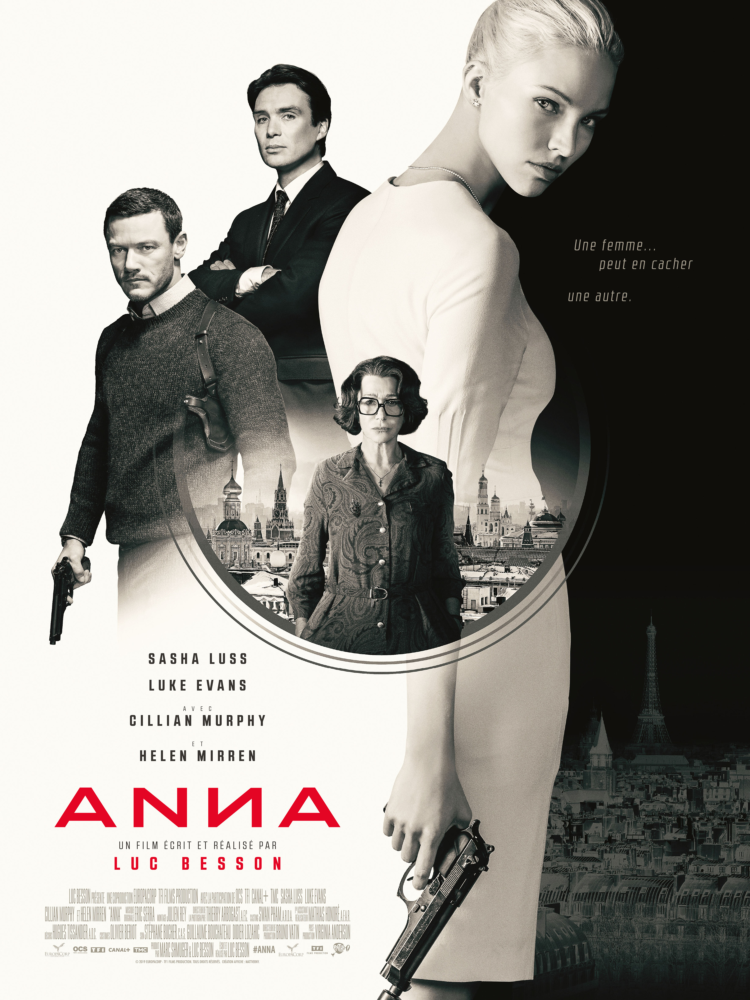
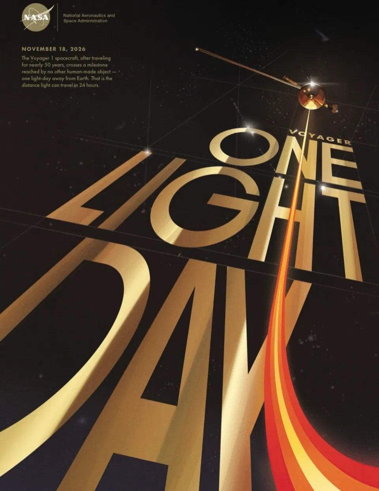

* a woman can hide another

> we are governed, our minds are molded, our tastes formed, our ideas suggested, largely by men we have never heard of. -- [Edward Bernays, 1891-1995, the father of public relations](https://en.wikipedia.org/wiki/Edward_Bernays), Propaganda, 1928

> Deregulation is a transfer of power from the trodden to the treading. It is unsurprising that all conservative parties claim to hate big government. ― George Monbiot

one piece of propaganda has three parts, grabbing your attention, sticking to your mind, and triggering the intended actions from you. this is just one part of practical psychology that includes cult, trading, sales, and more.

### news

* 2026-11-21: The S&P 500 fell every day this week, with four drops of 1% or more. That had happened only in 1962, 1974, 1978, the week after the 9/11 attacks in 2001 and October 2008, according to Bespoke Investment Group. What a week and what a month! the blue wave of mid-term triggered fears about anti-AI and anti-datacenter policy. Jensen Huang of Nvidia scandal. Anthropic IPO. Fed rate hike in coming December, .25 or .50 percent?  

* 2026-11-16: **NVDA on Tuesday (11-17 after bell).** Retail TGT on Wednesday, WMT and ROST on Thursday. **Anthropic IPO on Wednesday (11-18).** BIDU on Monday (11-16) and BABA on Thursday 11-19. **For NVDA this past week's upheaval won't impact earnings this quarter or next. Nvidia has sales locked in well in advance,**  meaning its bottom line won't take a hit for some time, if at all. Over the next month, Huang, Nvidia general counsel Tim Teter, and Secretary of Commerce Howard Lutnick are all expected to testify and answer questions from both chambers of Congress about not only Huang's conduct, but potential violations of US export policy.

* 2026-11-16: The case for Huang starts with paperwork that doesn't exist. He has said **Nvidia has never signed a contract with chipmaker TSMC in three decades of business.**

### notes

* [As china ages, by Carl Minzner](https://global.oup.com/academic/product/as-china-ages-9780197678596)

* movie Anna 2019

> [quotes](https://www.moviequotesandmore.com/anna-2019-best-movie-quotes/)

>> [she cuts her own wrist]

>> Alex Tchenkov: I think you've made the wrong decision.

>> Anna: You talk about turning points and choices. Those are just pretty words, if it means it's going to take me to another shitty town, in another shitty box. 

>> Alex Tchenkov: You have a right to make your own choices in your life. Go here, go there. Say yes, say no. But what you can't do is reject life itself. Your life was a gift. Who gave it to you?

>> Anna: My parents.

>> Alex Tchenkov: And this is how you honor them? This is what your father would want for you? Their lives are over. But yours isn't. Have a little faith.

>> Anna: Last time I put my faith in men, look where it got me.

>> Alex Tchenkov: Never put your faith in men, Anna. Put faith in yourself.

>> [Anna puts her hand on the cut on her wrist to stop the bleeding]

> [transcript](https://scrapsfromtheloft.com/movies/anna-2019-transcript/)

>> Olga: It takes more than intelligence to act intelligently.&#8221; Dostoyevsky. 

>> Anna: Like a captive cast to the bottom of a deep dry well, I know not who I am, not what awaits me. Yes, it's clear to me that in this cruel and obstinate struggle with Satan, I'm fated to emerge victorious. Then mind and matter shall fuse in perfect harmony, and the reign of universal will shall begin.

>> Olga: Hmm. Chekhov. Seagull. Act one. The play within the play.

> [Anton Chekhov Seagull quote](https://www.goodreads.com/work/quotes/3200341)

>> In all the universe nothing remains permanent and unchanged but the spirit.

>> We should show life neither as it is, nor as it should be, but as we see it in our dreams.

>> NINA: I am alone. Once in a hundred years my lips are opened, my voice echoes mournfully across the desert earth, and no one hears. And you, poor lights of the marsh, you do not hear me. You are engendered at sunset in the putrid mud, and flit wavering about the lake till dawn, unconscious, unreasoning, unwarmed by the breath of life. Satan, father of eternal matter, trembling lest the spark of life should glow in you, has ordered an unceasing movement of the atoms that compose you, and so you shift and change for ever. I, the spirit of the universe, I alone am immutable and eternal. [A pause] **Like a captive in a dungeon deep and void, I know not where I am, nor what awaits me. One thing only is not hidden from me: in my fierce and obstinate battle with Satan, the source of the forces of matter, I am destined to be victorious in the end. Matter and spirit will then be one at last in glorious harmony, and the reign of freedom will begin on earth.** But this can only come to pass by slow degrees, when after countless eons the moon and earth and shining Sirius himself shall fall to dust. Until that hour, oh, horror! horror! horror! [A pause. Two glowing red points are seen shining across the lake] Satan, my mighty foe, advances; I see his dread and lurid eyes.

* neoliberalism

> capitalism is an economic system founded on colonial looting. it operates on a constantly shifting and self-consuming frontier, on which both state and powerful private interests use their laws, backed by the threat of violence, to turn shared resources into exclusive property, and to transform natural wealth, labor, and money into commodities that can be accumulated.

* [Milovan Djilas，1911—1995](https://en.wikipedia.org/wiki/Milovan_Djilas)

> Yugoslav communist politician, theorist and author. best-known and most prominent dissidents in Yugoslavia and all of Eastern Europe.

> The New Class: An Analysis of the Communist System, New York: Frederick A. Praeger, Inc., 1957.

* [richard posner, 1939-2026](https://en.wikipedia.org/wiki/Richard_Posner)

> [richard posner before the law](https://www.lawyersgunsmoneyblog.com/2026/11/richard-posner-before-the-law)

> overcoming law

* "1958年我进大学，食堂一个月的伙食费仅需十元上下。"

* "文字狱的更深层原因，是权力对不确定性的恐惧。"中国人一直讲究谨言慎行，但谨言慎行和自我审查之间，有清晰的界限。前者出于对他人的尊重，后者出于对权力的恐惧，前者让人变得得体，后者让人变得虚伪。区分这两者很难，因为它们的外在表现几乎一模一样，可内心的感受完全不同，一个是自愿的克制，一个是被迫的沉默。

* Richard Smoley (1956-), Seven Games of Life and how to play, 2023

> the games of survival, love, power, creativity, pleasure, and courage.

* [Walter Lippmann, 1889-1974, father of modern journalism](https://en.wikipedia.org/wiki/Walter_Lippmann)

> book: Public Opinion, by Walter Lippmann, 1922

> Though a journalist himself, Lippmann did **not assume that news and truth are synonymous.** For Lippmann, the "function of news is to signalize an event, the function of truth is to bring to light the hidden facts, to set them in relation with each other, and make a picture of reality on which men can act." 

> To Lippmann, democratic ideals had deteriorated: voters were largely ignorant about issues and policies and lacked the competence to participate in public life and cared little for participating in the political process.

> **distorted information was inherent in the human mind.** People make up their minds before they define the facts, while the ideal would be to gather and analyze the facts before reaching conclusions.

* [bank of nvidia](https://hntrbrk.com/investigations/nvidia)

> Nvidia ($NVDA) no longer just sells chips. It invests in its customers, buys their computing capacity, and backstops their rent. Its commitments show how much the roughly $5 trillion company has riding on the AI boom. 

> Transforming itself into the primary hub of the circular AI economy has helped make Nvidia the first public company in history to crack the $5 trillion threshold. But there is also substantial risk, especially if weaker players in the ecosystem start to wobble. 

> In theory, any losses Nvidia suffers as a result of its investments in companies like CoreWeave ($CRWV) should be manageable. But when investor confidence cracks, as it did in the 2008 subprime crisis, **the circular economy can turn into a circular firing squad, with losses rippling in ways that are impossible to see until it happens**. Another danger is if the competitive landscape shifts as alternatives like Google’s TPU chips and Amazon’s Trainium chips begin to make inroads, while a greater share of compute is devoted to inference that can be handled by the CPU chips rather than the GPU chips that are Nvidia’s core differentiator.

* [beauty is everywhere, but what is it for](https://thereader.mitpress.mit.edu/beauty-is-everywhere-but-what-is-it-for/): beauty is the feel of order in the chaos of the world. beauty is one way to simplify the world in some ways.

> beauty is the shape of desire. never to be satisfied. never stop finding. Beauty is hard to define and put boundaries to, but the feeling of awe when faced with it is real.

> book: Sentience: The Invention of Consciousness, by Nicholas Humphrey 

> book: Why the world is so beautiful?: our minds in search of nature's rhymes, by Nicholas Humphrey

> Surrealism’s Breton - Beauty will be convulsive or it will not be.

> [Nick Cave and the Bad Seeds: nature Boy](https://www.youtube.com/watch?v=JquzYr-5bE4): My father said, don’t look away. You got to be strong, you got to be bold, now. He said, that in the end it is beauty. That is going to save the world, now.

> To accept the beauty of the world is to accept its potential loss.

* [book: invisible doctrine: The Secret History of Neoliberalism, by George Monbiot, Peter Hutchison, 2024](https://www.goodreads.com/book/show/199393180-invisible-doctrine)

* voyager 1 is now one light-day away from us

> On Wednesday, November 18 at 5:16:07 a.m. EST, Voyager 1 will be one light-day from Earth: about 16.1 billion miles (25.9 billion km), the distance light covers in 24 hours. It will be the first human-made object to get that far. Launched in 1977, it will have taken just over 49 years to cover that single light-day.

> The fact that it took half a century to travel one light-day, and that the nearest stars are light-years away, just underscore how vast the Universe is.

* trading psychology 

> Attention is a scarce resource. **When there are many alternatives, options that attract attention are more likely to be considered, hence more likely to be chosen, while options that do not attract attention are often ignored.** 

> **Human beings have bounded rationality. There are cognitive—and temporal—limits to how much information we can process.** We are generally not able to rank hundreds, much less thousands, of alternatives. Doing so is even more difficult when the alternatives differ on multiple dimensions. One way to make the search for stocks to purchase more manageable is to limit the choice set. It is far easier, for example, to choose among ten alternatives than a hundred.

> Which attention-grabbing stocks investors buy will depend upon their personal preferences. Contrarian investors, for example, will tend to buy out-of-favor stocks that catch their eye, while momentum investors will chase recent performers.

> First, most individual investors hold relatively few common stocks in their portfolio. Second, most individual investors sell only stocks that they already own — that is, they do not sell short. Thus, investors can, one by one, consider the merits — both economic and emotional — of selling each stock they own. Rational investors are likely to sell their past losers, thereby postponing taxes; behaviorally motivated investors are likely to sell past winners, thereby postponing the regret associated with realizing a loss (see Shefrin and Statman, 1985); thus, to a large extent, while individual investors are concerned about the future returns of the stocks they buy, they focus on the past returns of the stocks they sell.

