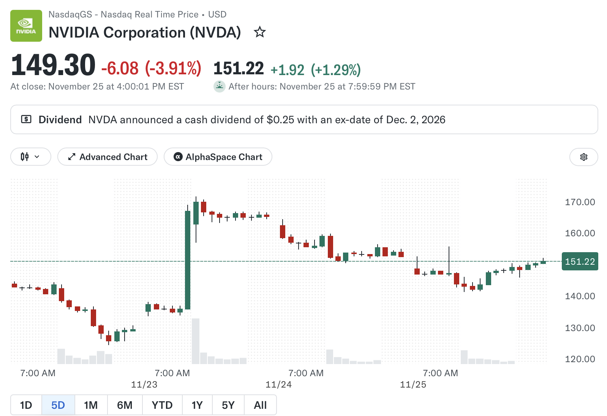

### news

* Last Friday had seen that Nasdaq wiped out its 2026 gain after Anthropic's IPO, Jensen Huang's scandal and the mid-term victory of Democratic party. this may be the start of AI bubble bursting. the reason might be that rate hike in December, and the current price of AI stocks is not sustainable. A blue chip is a stock issued from a well-established, high-quality company that’s seen as reliable and stable.

* [NVIDIA CHIP GUIDED THE RUSSIAN AI DRONE THAT KILLED THREE UKRAINIANS, HAYE KESTELOO · AUGUST 24, 2026](https://dronexl.co/2026/08/24/nvidia-jetson-russian-ai-drone-killed-three-zaporizhzhia/)

> A Russian Molniya attack drone that picked its own target with an Nvidia Jetson Orin computer module killed three civilians at a gas station in Zaporizhzhia on July 6, 2026. 

* Jensen Huang reinstated as CEO and president of Nvidia

> 2026-11-23: Nvidia's (NVDA) board on Monday announced that it has reinstated Jensen Huang as CEO and president of the chip giant. Nvidia stock rose more than 30% following the news. 

> 2026-11-24: Shares of Nvidia fell nearly 4% in premarket trading on Tuesday after a 31.2% surge on news that founder Jensen Huang had been reinstated as CEO. That came just 12 days after he resigned amid a personal scandal and federal chip-export probes. The dramatic reversal followed intense lobbying from President Donald Trump and Vice President JD Vance, who intervened directly with directors and said Huang had been cleared of national security concerns. **Wall Street** analysts were universally **positive** on the stunning turn of events, and think the rally may just be starting. (with the involvement of Trump admin, the scandal of Huang leads to another **bigger scandal of Trump.** )

> 2026-11-25: Shares of Nvidia (NVDA) fell more than 5% in premarket trading on Wednesday (11-25) following a 5.86% drop on Tuesday, as investor fears over the health of the AI trade returned.

* Record-breaking rain lashes California’s Bay area as ‘atmospheric river’ arrives

> Heavy rain pounded California’s Bay area, with record rainfall in downtown San Francisco and flooding and power outages across the region, as an “atmospheric river” arrived on Wednesday and dumped precipitation across the state. 

> Downtown San Francisco saw the most rainfall before noon in 76 years, at 2.11in, surpassing a record from 1950.

> 26年11月18日（周三），本季首场强“大气河流”（Atmospheric River）风暴横扫旧金山湾区，旧金山市中心单日降雨量达 2.64 英寸，打破了保持108年的同日降雨纪录，也是该市有记录以来11月单日第六高降水量。 南湾（圣何塞）当天录得 2.04 英寸 降雨，打破了1950年的同日纪录，位列该市历年11月单日降雨量第二。 东湾与中半岛。 奥克兰（Oakland）、中半島及东湾多座城市降雨量也普遍达到至少 2 英寸。

### Act II: Jensen Huang's return

* [George Noble, investor, former fund manager at Fidelity on X, 2:16PM Nov23,2026](https://x.com/gnoble79/status/2124960416539480266)

> Bringing Jensen Huang back is **the most DESPERATE move of this entire AI bubble.** Enron's board brought Ken Lay back as CEO in August 2001 to calm the market, and the company filed for bankruptcy 110 days later. We're short and we gave some money back today, which doesn't bother me one bit, because **NOTHING about the economics of AI changed this morning.** The whole system is still **cash flow negative** by hundreds of billions of dollars, and a CEO comeback doesn't add a single dollar to that. Again: Show me the money.

> When a board rehires the CEO who resigned 12 days earlier, with the White House pushing for it, **that tells you how desperate things really are.** Nvidia was already sliding before anyone heard about Jensen's personal life, and I still expect **neoclouds like CoreWeave and IREN to go BANKRUPT.** We put up a 57% long/short spread by sticking to fundamentals and valuation, and we keep pressing our shorts. The number-go-up crowd can keep chasing headlines. History won't be kind to Jensen Huang and NVIDIA.

> [the noble update on substack](https://georgenoble.substack.com/)

* [IBT: Trump’s New Filing Reveals Nvidia, SpaceX And Tesla Purchases. White House Says He Didn’t Direct Trades.](https://www.ibtimes.com/trump-financial-disclosure-nvidia-spacex-tesla-purchases-3809977)

> The filing, signed by Trump on Nov. 1 and received by the ethics office on Nov. 5, identifies several purchases of Nvidia stock during September. Reuters calculated that the transactions included up to $265,000 in purchases and up to $15,000 in sales.

* [It's as insane as you think by Brian Philips, 2026-11-23](https://www.theringer.com/2026/11/23/national-affairs/jensen-huang-reinstated-nvidia-donald-trump-china-ai-chips)

> What. The. Fuck. Huang, you’ll remember, resigned as CEO of Nvidia, the multitrillion-dollar tech behemoth whose chips run the whole AI industry, less than two weeks ago. “Resigned” is putting it nicely. By all accounts, Huang was forced out by the Nvidia board following revelations that he’d been having an affair with a woman thought by the U.S. intelligence community to be a Chinese spy. Having an affair with a Chinese spy is a dubious life choice for most American CEOs, but it’s especially problematic when you run a company that’s legally barred from selling its most advanced products to China because the U.S. government considers them essential to national security. If the CEO of Boeing had been caught having an affair with a Soviet spy at the height of the Cold War, it wouldn’t have been great for his career. Two weeks ago, that was essentially Huang’s situation.

> Which is why it made perfect sense when, less than a week ago, the Nvidia board emphasized on the company’s quarterly earnings call that it did not intend to bring Huang back as CEO.

> This is — or ought to be — beyond all that. You should immediately understand this as one of the biggest scandals in American political history. It might be the biggest. **A president with a financial stake in a company is personally protecting that company’s CEO after he was caught helping the U.S.’s biggest geopolitical rival acquire assets restricted for national security.** Watergate was a minor speeding violation compared with this. Looking at this and thinking about Hillary Clinton’s email server makes me want to climb a tree.

> What it reveals, more than anything, is that keeping the AI bubble going is the only priority that matters to the oligarchs and political elites who currently run the United States. Huang’s ouster exacerbated already existing anxieties among tech investors; as of Friday, Nvidia’s stock had lost $2.6 trillion in value over just seven weeks. And this spurred a broader sell-off across the tech sector, one that not even Anthropic’s ludicrously massive IPO could stem. Last week, the S&P 500 went into a correction, having lost 10 percent of its value since October 6, and the Nasdaq index lost all its gains for 2026 to date. The possibility of a genuine AI implosion suddenly seemed real.

> [Brian Philips on bsky.app](https://bsky.app/profile/brianphillips.lol)

> [Brian Philips on Ringer](https://www.theringer.com/creator/brian-phillips)

> [Brian Philips on Goodreads](https://www.goodreads.com/author/show/17889502.Brian_Phillips)

### notes

* [the market monetarist](https://marketmonetarist.com/)

> 2026-11-23: Nvidia’s shares rose around 30% this Monday after the board reinstated Jensen Huang as CEO. Yet since he admitted his affairs on November 8, the shares had lost about a third of their value. Today they won a large part of it back. So what did the market lose – and then get back?

> Jensen Huang is the same man today as he was 11 days ago. He has not become better or worse at running a company since then. Not management skills. **Access to political power.** Nvidia’s earnings increasingly depend on decisions made in the White House. Can it sell chips to China? How big a cut of those sales does the US government take? How strictly are export controls enforced? Huang had a direct line to President Donald Trump. That line is what shareholders were paying for.

> Nvidia is not the only example. When Elon Musk fell out with Trump in June last year, Tesla lost around 14% of its value in a single day. Not because the cars got worse, but because Musk’s relationship with the president did. And the US government is now a shareholder in Intel.

> When share prices move more on political connections than on earnings and management, the US stock market starts to look more like Turkey’s or Russia’s than the US market we used to know. **The problem is that a political guarantee only lasts as long as the politician stays in power.** Trump will not be president forever. And when the guarantee goes, so do the share prices.

* book: [Stephen Witt](https://www.straitstimes.com/life/arts/jensen-huang-biographer-stephen-witt-on-nvidia-founders-cult-of-personality), [the thinking machine: Jensen Huang, Nvidia And The World’s Most Coveted Microchip, 2025.](https://en.wikipedia.org/wiki/The_Thinking_Machine:_Jensen_Huang,_Nvidia_and_the_World%27s_Most_Coveted_Microchip) (中译《黄仁勋：英伟达之芯》) 

* 景凯旋

> 西方现代文学和哲学的思想脉络，始于文艺复兴时期上帝的退场，世界进入了世俗化时代。康德的理性为自然立法代表了思想史上的哥白尼式革命，但与此同时，理性化、世俗化的过程也是一个价值贬值的过程。换言之，近代的思想突破和困扰其实都是源于人是目的的观念，所有西方现代文学家和哲学家在赋予人生意义时，最终全都会不约而同地归结到两个字：行动。

> 然而，正如二十世纪已经展示给我们的，行动的观念给世界带来的问题不比古典时代的沉思更小，试图改变世界的雄心设计出巨大的社会工程，结果却造成巨大的灾难。这是一个反向的辩证法，人成为自身的造物主，结果却发现，人只是孤独地站在偶然性的荒原上，失去了哈维尔所说的“绝对的地平线”。

> 我们的心灵往往会蒙骗自己，使我们置身于时光的错觉中。只要我们还活着，死亡仿佛就是很遥远的事。

* book: [Nancy Isenberg](https://en.wikipedia.org/wiki/Nancy_Isenberg), Aristocracy, American Style: Class Privilege and the Persistence of Elite Power, 2026

> “Poor whites are still taught to hate—but not to hate those who are keeping them in line. Lyndon Johnson knew this when he quipped, “If you can convince the lowest white man he’s better than the best colored man, he won’t notice you’re picking his pocket. Hell, give him somebody to look down on, and he’ll empty his pockets for you.” -- Nancy Isenberg, White Trash: The 400-Year Untold History of Class in America

* book: [James C. Scott, 1936-2024](https://en.wikipedia.org/wiki/James_C._Scott)'s IN PRAISE OF FLOODS is featured in [New York Review of Books](https://www.nybooks.com/articles/2026/11/19/the-flood-of-life-in-praise-of-floods-scott/).

* [GEORGE CARLIN, 1937-2008](https://en.wikipedia.org/wiki/George_Carlin) in 1996 on the death penalty.

> The Death Penalty doesn’t mean anything unless you use it on people who are afraid to die - like the Bankers who launder the drug money!

> Some people see things that are and ask, "Why?" Some people dream of things that never were and ask, "Why not?"

> Never underestimate the power of stupid people in large groups.

> A house is just a place to keep your stuff while you go out and get more stuff.

> The politicians are put there to give you the idea that you have freedom of choice. You don't. You have owners. They own you. They own everything.

> It's called the American Dream, because you have to be asleep to believe it.

> Here's all you have to know about men and women: **women are crazy, men are stupid. And the main reason women are crazy is that men are stupid.**

* Invalid URL

> Edgesuite.net is run by Akamai Technologies (www.akamai.com). Akamai is a content delivery network (CDN) that is used by a large percentage of Internet sites (something like one third to one half of all traffic goes through Akamai). Normally the addresses don’t show up, but sometimes you will see edgesuite.net which is handled by Akamai. In this case, you aren’t the victim of phishing, but rather the website is using external CDN to speed up delivery of your traffic.

* neoliberalism

> privatization, deregulation, trade liberalization, the abandonment of capital controls, and “fiscal austerity,” which meant slashing state spending on health, education, and other public services. these decisions were imposed without people being given the chance to vote on them: the poorer nations had no choice but to implement them, regardless of what their populations thought. In other words, when neoliberal policies couldn’t be imposed domestically, they were imposed internationally.

> It is highly misleading to describe neoliberalism as “free-market economics.” In many ways it’s quite the opposite.

> As a general rule, privatization is legalized theft from the public realm.

> The destruction of the wealth and power of the elite, caused largely by two tectonic events—the Depression and the Second World War—created an opening for the redistributive policies of John Maynard Keynes, among others. 1945 - 1975.

> The Global North’s postimperial interventions were justified with the rhetoric of the Cold War—defending the Western sphere of influence against Soviet expansionism—but their underlying purpose was to secure resources and territory for the dominant capitalist powers. 

> For while neoliberal capitalism continues to loot the South to enrich the North, it also loots the future to enrich the present.

> for neoliberalism, the market is the power of money.

> human beings, ultra-social mammals whose brains are wired to respond to other people, are being forced apart. Technological change plays a major role, but so does ideology.

> three of the neoliberalism’s core tenets distilled: 1. everyone is responsible for their own destiny, and if you fall through the cracks, the fault is yours and yours alone. 2. the state has no responsibility for those in economic distress, even those without a home. 3. here is no legitimate form of social organization beyond the individual and the family.

> Together we are powerful, alone we are powerless.

 
